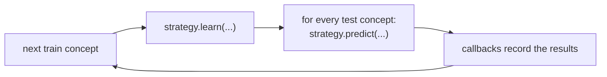

# Core concepts

This page explains the ideas pyCLAD is built on and how they fit together. It is the background for
[your first experiment](../getting_started.md) and for the reference pages.

## Concepts and datasets

A **concept** is a self-consistent behaviour of the normal class, together with the anomalies that occur with it: one
distribution, activity, machine state or task. For example, when monitoring a person's health, *resting*, *jogging* and
*eating* are different concepts: what is normal while jogging would be anomalous while resting.

In pyCLAD a `Concept` has:

- a `name`. A train concept and a test concept with the same name belong together;
- `data`, with the first axis running over samples;
- `labels`, one per sample: **`0` for a normal sample and `1` for an anomaly**. Labels are required for test
  concepts. Unsupervised strategies treat training data as normal.

A **dataset** (`ConceptsDataset`) is a list of train concepts and a list of test concepts. **The order of the train
concepts is the continual order**: the order in which the strategy learns them. Built-in benchmarks offer several
orderings, because the order changes the results.

## Models

A **model** is an anomaly detector. It has two methods:

- `fit(data)` trains it.
- `predict(data)` returns a `PredictionResults` with two arrays, one entry per sample:
    - `anomaly_scores`, where **a higher score means a more anomalous sample**;
    - `y_pred`, the binary decision (`0` normal, `1` anomaly), derived from the scores with a threshold.

Ranking metrics such as ROC-AUC use only `anomaly_scores`. Threshold-based metrics such as F1 use `y_pred`, so they
also depend on how the model chose its threshold.

pyCLAD wraps PyOD detectors, PyTorch autoencoders and other models behind this interface; see [Models](../models.md).

## Strategies

A model on its own simply learns from whatever data it is given. A **strategy** decides *when*, *how* and *with what
data* the model is updated as concepts arrive. Its goal is to balance two things: *adaptation* to new concepts and
*retention* of old ones. Forgetting the old concepts while learning new ones is called *catastrophic forgetting*.

Strategies fall into a few families:

- **Baselines**: `Naive` retrains on each new concept (a lower bound); `Cumulative` retrains on all data seen so far
  (an upper bound that does not scale); `MSTE` keeps one model per concept.
- **Replay**: keeps a bounded memory of past samples and trains on it alongside new data.
- **Regularization**: penalizes changes to what the model learned before (EWC, LwF, DER++).
- **Drift-aware**: detects concept changes and new or recurring concepts on its own (VLAD).

See [Strategies](../strategies.md) for the full list.

## Scenarios

A **scenario** feeds the train concepts to a strategy one after another and evaluates it after each one. Scenarios
differ in what they tell the strategy about the stream:

| Scenario | Concept boundaries | Concept identity | What the strategy is given |
|---|---|---|---|
| **Concept-aware** | known | known | `learn(data, concept_id)` once per concept; `predict(data, concept_id)` |
| **Concept-incremental** | known | unknown | `learn(data)` once per concept, so each call is one whole concept |
| **Concept-agnostic** | unknown | unknown | `learn(data)` on batches of 256 samples, which may come from any concept |

The less a scenario reveals, the harder it is. A strategy implements the contract of every scenario it can honestly
support. A strategy may *infer* what it is not given from the data, for example by detecting drift (as VLAD does),
but it may not obtain it any other way. This is what makes results in the different scenarios comparable.

`SupervisedConceptIncrementalScenario` is the concept-incremental scenario for strategies whose models train on labels:
it passes the whole `Concept`, with its labels, to `learn`.

## The evaluation protocol

Each scenario runs the same loop. After learning each train concept, the strategy is evaluated on **all** test
concepts: the ones learned earlier, the current one and the ones still to come.

The results form a matrix $R$, where $R_{i,j}$ is the score on concept $j$ after learning concept $i$:

- the **diagonal** shows how well each concept was learned;
- **below the diagonal** ($i > j$) shows what happened to earlier concepts. A drop there is forgetting;
- **above the diagonal** ($i < j$) shows performance on concepts not yet seen.

A **base metric** (ROC-AUC, average precision, F1) fills each cell. **Continual metrics** summarize the matrix: the
continual average, backward and forward transfer, and the forgetting measure. When a cell cannot be computed (for
example ROC-AUC on a test concept with a single class), it is `NaN`, and so is every metric that reads it. pyCLAD
never replaces an undefined value with a made-up number. See [Metrics](../metrics.md).

## Callbacks and output

**Callbacks** are hooks the scenario calls before and after the scenario, each training step and each evaluation.
The metric, time, memory and energy measurements are all callbacks; see [Callbacks](../callbacks.md).

Everything that shapes a result reports itself through `info()`: models and strategies their hyperparameters,
datasets their name and size, callbacks their results. `JsonOutputWriter` saves all of them in one JSON file, which
is enough to tell two runs apart; see [Output](../infoprovider.md).

## Randomness

Strategies and models draw random numbers from Python's `random`, NumPy and PyTorch. `set_seed(seed)` seeds all of
them, so call it once at the start of a script and pass what it returns to the output writer, which saves the seed
with the results. Components that take their own `seed` or `rng` argument use it instead.

One seed is one sample. To claim that one method beats another, run several seeds and report the mean and the spread.
